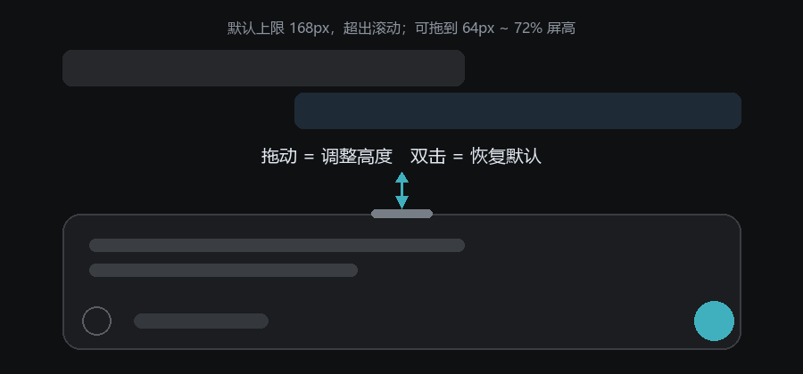

# dsh-composer-resize

> **可拉伸的输入框** — 给 DeepSeek Harness 的聊天输入框加一条拖动把手，随手改高度，并且默认不再长到半屏。



DSH 的输入框原本会跟着内容一直长，长到 336px 才开始滚动，而且不能拖。这个插件把它变成：

- 输入框顶部有一条细把手，**鼠标移上去或聚焦时出现**；
- **随时可拖**：不管现在只有一行字还是已经很长，往上拖就变高、往下拖就变矮
  （64px ~ 72% 屏高），拖动时右上角显示当前像素值；
- 拖动后进入**固定高度模式**：高度就是你要的那个值，内容超出在框内滚动，不再自己忽高忽低；
- **双击把手**回到**自动增高模式**：跟着内容长，封顶 168px（比官方的 336px 矮一半）；
- 松手即记住（`localStorage`），重启浏览器/DSH 仍是这个高度；
- 只改 `[data-input-scroll]` 的 `height` / `max-height`，不碰任何 React 组件，也不影响发送、附件、斜杠命令。

## 安装

```bash
git clone https://github.com/ayachinene285/dsh-composer-resize.git
dsh plugin --profile desktop add "$(pwd)"
```

或者手动：把目录放进 `~/.dsh/profiles/<profile>/node_modules/dsh-composer-resize`，
在 profile 的 `package.json` 里 `dependencies` 加 `link:` 指向它、`dsh.profile.bundles` 末尾加 `dsh-composer-resize`，
然后**完全退出 DSH 再打开**。

## 实现方式

不接管任何组件，纯 DOM 增强：

1. 找到 `[data-composer-card]`（输入卡片，`position: relative`），在它顶部插入一条 10px 高的把手；
2. 拖动从"当前实际高度"起算，第一次移动后切到 `height/min-height/max-height` 三件套的**固定高度**；
   双击则清掉内联 `height`，回到只设 `max-height` 的**自动增高**；
3. `MutationObserver` + 定时兜底，React 重建输入框后自动补回；
4. 插件卸载时移除把手、样式与所有内联高度。

宿主侧（`lib/index.js`）是空实现，只作为插件入口。

## 已知边界

- 只影响聊天输入框；队列编辑框（QueueDock）保持官方样式。
- 固定高度模式下不会自动增高（这是有意的）；想恢复自动增高就双击把手。
- 高度按“本次浏览器”记住，不写进 DSH 配置。
- 依赖 `data-composer-card` / `data-input-scroll` 两个稳定标记；DSH 若改名，插件会静默不生效（不会报错）。

## License

[MIT](LICENSE)
